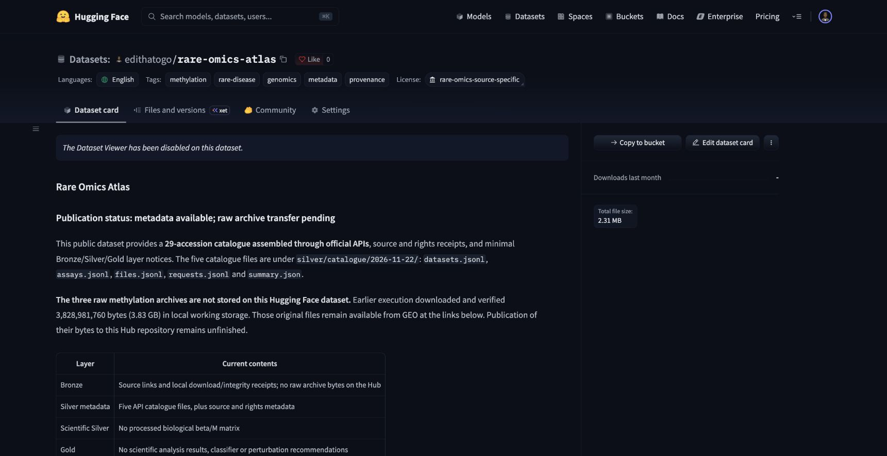

# Hugging Face publication — verified metadata, raw transfer pending

## Observed result

The public [Rare Omics Atlas dataset](https://huggingface.co/datasets/edithatogo/rare-omics-atlas) contains **14 verified objects totalling 2,304,170 bytes** at immutable revision [`3f1cb8e64d8e31e7e40773441ba6266714569d05`](https://huggingface.co/datasets/edithatogo/rare-omics-atlas/tree/3f1cb8e64d8e31e7e40773441ba6266714569d05). The [official API read-back receipt](hf-metadata-publication-2026-11-22.json) matches every selected path, size and content identity. A recursive inventory confirms that no raw archive files are present.

The existing [estate registry](https://huggingface.co/datasets/edithatogo/dataset-estate-registry) now records this canonical dataset at [`bc551011281caabca9cc2d6e37a72459d8367242`](https://huggingface.co/datasets/edithatogo/dataset-estate-registry/blob/bc551011281caabca9cc2d6e37a72459d8367242/catalog.json). Its 79 entries preserve all 78 prior entries and the existing policy exactly. The new status is `metadata_catalogue_published_raw_pending`; only the new row and the catalogue generation time changed. [Candidate review](hf-estate-candidate-review-2026-11-22.json); [immutable read-back](hf-estate-publication-2026-11-22.json).

| Layer | Published now |
|---|---|
| Bronze | Direct GEO source links and local download/integrity receipts |
| Silver metadata | Five catalogue files; source and reuse metadata |
| Scientific Silver | No biological beta/M matrix |
| Gold | No scientific results |

The five catalogue files represent 29 source accessions (28 GEO and one PRIDE), 2,532 series–GSM memberships, 2,465 unique GEO assays and 4,514 declared file records. They do not establish independent participant or cohort counts. The completed API-harvest track remains [T08](../../conductor/archive/t08_catalogue_20261122/index.md).



## Source and route

The actual transfer used the ordinary Hub browser editor, followed by the official `huggingface_hub==2.4.0` API for read-only verification. The automated publisher and GitHub Actions workflow did not execute a remote upload. Their configured upload parent guard was not exercised by this UI route. Multiple UI commits preceded the final accepted immutable revision.

Ten metadata files remain byte-identical to their recorded blobs at GitHub source `8cfc85110911a2991301b358e4510e28026d13b8`. The dataset card, Bronze notice and licence notice were revised to state the metadata-only publication status. Those three new notices are bound by their hashes and are committed alongside this receipt; they do not claim that earlier Git origin. The [staging manifest](../releases/2026-11-22/hub-staging/staging-publication-manifest.json) describes exactly this subset, and its own bytes were verified as the fourteenth Hub object.

The live Hub validator rejected the original card's human-readable `license_name` and relative `license_link`. Both the staging card and the planned full-release card now use the required slug and HTTPS link. The original failure, old hashes, precise two-field change and prospective 18-object dry-run are retained in the [fix receipt](../releases/2026-11-22/hub-staging/card-validation-fix-receipt.json) and [dry-run record](hf-cardfix-dry-run-2026-11-22.json). The dry-run used no asserted source revision because the corrective commit had not yet been published; it made no Hub call.

The [staging review](hf-staging-review-2026-11-22.json) accepts the bounded metadata notices and verification scope. The [final independent review](hf-final-ponytail-review-2026-11-22.md) accepts the corrected verifier, its focused receipt-path regression and the final 14-object replay. [Offline check receipt](hf-verifier-receipt-guard-2026-11-22.json) and [test output](hf-verifier-receipt-guard-2026-11-22.log) retain the original failures and the passing 16-test suite. Ponytail review keeps the original official Hub client and existing publisher checks; no alternate authentication/upload protocol, hosted lakehouse or second catalogue service was introduced.

## Raw files and remaining task

The original local GEO archives total **3,828,981,760 bytes**: GSE97362 (2,181,539,840), GSE116300 (565,248,000) and GSE218186 (1,082,193,920). SHA-256, TAR/member structure and full gzip integrity checks are recorded separately. The archives contain 341 red/green IDAT pairs, including controls and other diagnoses. These are file-integrity findings, not completed methylation QC or a count of independent affected participants.

The available Hugging Face sandbox creation request returned **HTTP 402 Payment Required**. No remote sandbox was created. Two ordinary browser download attempts timed out without returning a usable downloaded-file path. The UI text editor remained functional and was used for the metadata subset. These transport outcomes do not imply that ordinary Hub storage requires purchasing remote compute.

The existing [manual publication workflow](../../.github/workflows/publish-hf.yml) is the concrete remaining transfer route: use a trusted `main` revision on an official self-hosted runner with the selected platform labels and `rare-omics-local`, and supply a scoped `HF_TOKEN` Actions secret. The publisher fetches the three exact GEO archives, checks their bytes and hashes, uploads the full manifest, and verifies the resulting immutable Hub revision. Runner registration, credential configuration and an actual owner-device execution have not been observed in this session.

The corrected [full manifest](../releases/2026-11-22/manifest.json) requires its new reviewed GitHub commit before that upload. A later full publication must also update the current metadata-only notices and estate status. Source-linked Bronze is already useful; optional mirroring is not a prerequisite for eligible local technical work. **Full T09 remains open and is not archived.**

## Reproduce the read-only metadata check

From this checkout with the recorded `8cfc851` Git commit available locally, using the existing locked operational environment:

```sh
uv run --project tools/hf-release --frozen python \
  research/releases/2026-11-22/hub-staging/verify-metadata.py \
  --hub-revision 3f1cb8e64d8e31e7e40773441ba6266714569d05 \
  --include-staging-manifest \
  --receipt /tmp/rare-omics-hf-metadata-readback.json
```

Use an appropriate writable receipt path on Windows. The checker reuses the reviewed publisher's path/hash and remote-object checks, verifies all ten immutable Git origins, verifies the three notice hashes, and checks raw-file absence at the pinned revision. It never uploads or requests an authentication token. It cannot mark the full archival release complete.

Source-specific reuse conditions and original attribution remain recorded. This metadata publication does not make an institutional HREC/IRB determination or qualify a clinical analysis. Those existing parent milestones remain visible; no additional approval process was added for this authorised metadata publication.
